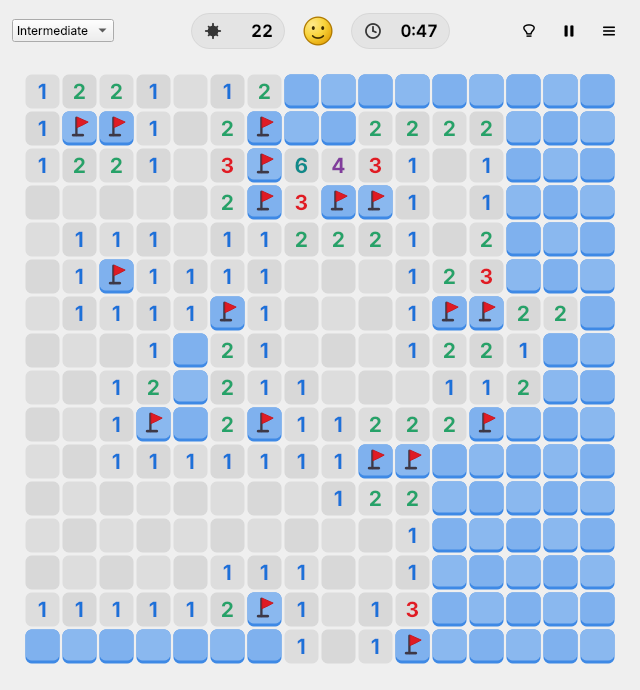
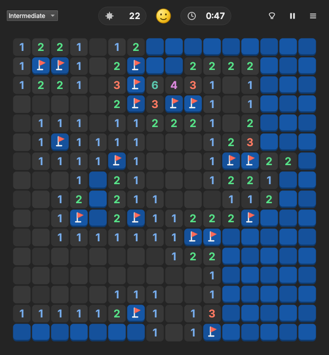
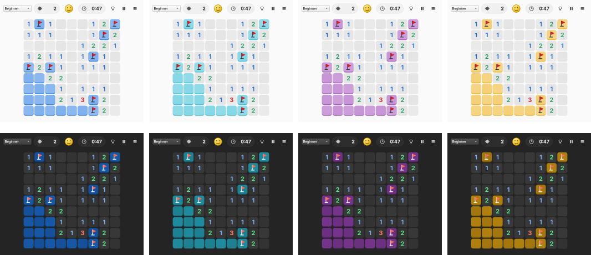

# OpenMine

A free and open source Minesweeper for Linux and Windows. Modern, clean, and
it follows your system theme: light or dark, and your desktop's accent colour,
changing live when you change them.



<details>
<summary>Dark style and accent colours</summary>



The board picks up your desktop's accent colour (GNOME, KDE Plasma and Windows):


</details>

## Features

- **Follows your system theme**: light/dark style and accent colour on GNOME,
  KDE Plasma and other desktops that use the XDG desktop portal, and on
  Windows 10/11. Changes apply instantly, no restart needed. You can also
  force light or dark in *Menu → Preferences → Appearance*.
- **Beginner, Intermediate, Expert and Custom** boards (up to 60 × 40).
- **Safe first click** that always opens up an area.
- **No-guess mode** (optional): every board can be solved by logic alone.
- **Hints** that point at a square that is *provably* safe, or at a wrong flag.
- **Chording** by clicking a satisfied number (or middle click / left+right click),
  optional question marks, long-press to flag on touch screens.
- **Full keyboard control.**
- **Statistics**: win rate, streaks and your 10 best times per board.
- Smooth animations (can be turned off), crisp vector graphics at any size,
  pause, and a resizable board that scales to the window.

## Contents

- [Install on Linux](#install-on-linux)
  - [Arch Linux (and Manjaro, EndeavourOS, …)](#arch-linux-and-manjaro-endeavouros-)
  - [Any distribution: Ubuntu, Debian, Fedora, openSUSE, Mint, …](#any-distribution-ubuntu-debian-fedora-opensuse-mint-)
  - [Run from source](#run-from-source)
- [Install on Windows 10/11](#install-on-windows-1011)
- [How to play](#how-to-play)
- [Where your data is stored](#where-your-data-is-stored)
- [Troubleshooting](#troubleshooting)
- [Development](#development)
- [License](#license)

## Install on Linux

OpenMine is written in Python with Qt 6 (PySide6). You need **Python 3.9+**;
everything else is handled for you.

### Arch Linux (and Manjaro, EndeavourOS, …)

The repository contains a `PKGBUILD`, so pacman manages the installation
like any other package (uses the official `pyside6` package).

**Install**

```sh
sudo pacman -S --needed base-devel git
git clone https://github.com/oreo1298/OpenMine.git
cd OpenMine/packaging/arch
makepkg -si
```

**Update**

```sh
cd OpenMine            # the folder you cloned
git pull
cd packaging/arch
makepkg -si
```

`makepkg` always builds the newest commit from GitHub. If it says *"A package
has already been built"*, you are already up to date.

**Uninstall**

```sh
sudo pacman -Rns openmine-git
rm -rf ~/.config/openmine     # optional: delete settings and statistics
```

You can also use the generic installer below on Arch; it automatically uses
the `pyside6` package if it is installed.

### Any distribution: Ubuntu, Debian, Fedora, openSUSE, Mint, …

`install.sh` installs OpenMine for your user (no root needed) and adds it to
your application menu. If your distribution's PySide6 (6.5 or newer) is
installed, it is used; otherwise the installer downloads PySide6 from PyPI
into a private folder, so nothing else on your system is touched.

**1. Prerequisites** (only Debian-based distributions need anything extra):

| Distribution | Command |
| --- | --- |
| Ubuntu, Debian, Mint, Pop!_OS, Zorin, elementary | `sudo apt install python3 python3-venv curl` |
| Fedora | nothing (optional, uses less disk space: `sudo dnf install python3-pyside6`) |
| Arch-based | nothing (optional: `sudo pacman -S pyside6`) |
| openSUSE and others | nothing |

**2. Install**

Either with one command:

```sh
curl -fsSL https://raw.githubusercontent.com/oreo1298/OpenMine/main/install.sh | bash
```

or, if you prefer to look at the script first or use git:

```sh
git clone https://github.com/oreo1298/OpenMine.git
cd OpenMine
./install.sh
```

Then start **OpenMine** from your application menu, or run `openmine` in a
terminal. The one-command version installs the latest release (or the
latest code if no release has been published yet).

To install for **all users** instead (into `/usr/local`, asks for your
password), add `--system`:

```sh
curl -fsSL https://raw.githubusercontent.com/oreo1298/OpenMine/main/install.sh | bash -s -- --system
# or, from a clone:
./install.sh --system
```

**Update**

Run the same command you installed with. It replaces the old version in
place and keeps your settings and statistics:

```sh
curl -fsSL https://raw.githubusercontent.com/oreo1298/OpenMine/main/install.sh | bash
# or, from your clone:
git pull && ./install.sh
```

Check which version you have with `openmine --version`.

**Uninstall**

```sh
~/.local/lib/openmine/uninstall.sh                 # per-user installation
/usr/local/lib/openmine/uninstall.sh               # --system installation
```

or, from a clone, `./uninstall.sh` (add `--system` for a system-wide
installation). Your settings and statistics are kept unless you add
`--purge`.

<details>
<summary>What exactly does the installer put where?</summary>

For a per-user installation (`PREFIX` = `~/.local`; for `--system` it is
`/usr/local`):

| Path | What |
| --- | --- |
| `PREFIX/bin/openmine` | Launcher |
| `PREFIX/lib/openmine/app/` | The game |
| `PREFIX/lib/openmine/venv/` | PySide6 from PyPI (only if your distribution's PySide6 isn't used) |
| `PREFIX/lib/openmine/uninstall.sh` | Uninstaller |
| `PREFIX/share/applications/io.github.oreo1298.OpenMine.desktop` | Menu entry |
| `PREFIX/share/icons/hicolor/*/apps/io.github.oreo1298.OpenMine.*` | Icons |
| `PREFIX/share/metainfo/io.github.oreo1298.OpenMine.metainfo.xml` | Software-center metadata |

Uninstalling removes exactly these. All options:

```text
./install.sh --help

  --user            Install for the current user in ~/.local (default)
  --system          Install for all users in /usr/local (uses sudo)
  --prefix DIR      Install into DIR instead
  --system-qt       Require the PySide6 package from your distribution
  --venv            Always download PySide6 into a private environment
  --ref REF         Branch, tag or commit to download (default: latest release)
  --uninstall       Remove OpenMine (with the same --user/--system/--prefix)
  --purge           With --uninstall: also delete settings and statistics
  -y, --yes         Don't ask for confirmation
```
</details>

### Run from source

```sh
git clone https://github.com/oreo1298/OpenMine.git
cd OpenMine
python3 -m venv .venv
. .venv/bin/activate
pip install -e .
openmine
```

## Install on Windows 10/11

1. Open the [latest release](https://github.com/oreo1298/OpenMine/releases/latest).
2. Download **`OpenMine-<version>-windows-setup.exe`** and run it. It installs
   for your user without needing administrator rights (you can choose to
   install for all users) and adds OpenMine to the Start menu.
3. Windows SmartScreen may warn about an unrecognised app because the
   installer isn't code-signed: click **More info → Run anyway**.

Prefer no installer? Download **`OpenMine-<version>-windows-portable.zip`**,
extract it anywhere and run `OpenMine.exe`.

- **Update**: download and run the newer setup file. It replaces the old
  version and keeps your settings and statistics. (Portable: replace the
  folder.)
- **Uninstall**: *Settings → Apps → Installed apps → OpenMine → Uninstall*.
  (Portable: delete the folder.) Settings and statistics are in
  `%APPDATA%\OpenMine`; delete that folder too if you want them gone.

From source: install [Python](https://www.python.org/downloads/) 3.9 or
newer, then in PowerShell:

```powershell
git clone https://github.com/oreo1298/OpenMine.git
cd OpenMine
py -m venv .venv
.venv\Scripts\Activate.ps1
pip install -e .
openmine
```

## How to play

Uncover every square that doesn't hide a mine. A number shows how many of the
eight surrounding squares contain mines. Your first click is always safe.

| Action | Mouse | Keyboard |
| --- | --- | --- |
| Uncover a square | Left click | Arrow keys to move, **Space** or **Enter** |
| Flag / unflag | Right click (long press on touch screens) | **F** |
| Uncover all neighbours of a number whose mines are flagged ("chord") | Click the number, middle click, or left+right click | **Space** on the number |
| Hint | 💡 button | **H** |
| Pause | ⏸ button | **P** |
| New game | Smiley button | **F2** or **Ctrl+N** |
| Beginner / Intermediate / Expert / Custom | Difficulty list | **Ctrl+1** … **Ctrl+4** |
| Statistics | Menu | **F4** |
| How to play | Menu | **F1** |

Everything else is in the **☰ menu**: appearance (follow system / light /
dark), no-guess boards, question marks, chording on click, and animations.

Games won with hints still count as wins, but their times are not added to
your best times. No-guess games are recorded separately.

Command line options: `openmine --help` (e.g. `--difficulty expert`,
`--theme dark` for one session, `--reset-window`).

## Where your data is stored

| | Settings and statistics |
| --- | --- |
| Linux | `~/.config/openmine/` (or `$XDG_CONFIG_HOME/openmine/`) |
| Windows | `%APPDATA%\OpenMine\` |

Both are small JSON files (`settings.json`, `stats.json`).

## Troubleshooting

**"Could not load the Qt platform plugin "xcb"" (Linux, X11 sessions).**
PySide6 from PyPI needs a few X11 libraries that minimal installations can
lack. The installer prints the exact command; on Debian/Ubuntu it is
usually `sudo apt install libxcb-cursor0`. Wayland sessions are not affected.

**OpenMine stopped starting after a big system update** (for example a new
Python version on Arch or Fedora). Run the installer again; it rebuilds its
private environment for the new Python. With the Arch `PKGBUILD`, rebuild with
`makepkg -sif`.

**The colours don't follow my desktop.** On Linux the light/dark style and
accent colour come from the XDG desktop portal (`xdg-desktop-portal` plus
your desktop's backend, installed by default on GNOME and KDE Plasma) and are
read with `gdbus` or `busctl`. Make sure *Menu → Preferences → Appearance* is
set to *Follow System*.

## Development

```sh
python3 -m venv .venv && . .venv/bin/activate
pip install -e ".[test]"
QT_QPA_PLATFORM=offscreen pytest
```

Project layout:

| Path | |
| --- | --- |
| `src/openmine/game.py` | Game rules (pure Python, no Qt) |
| `src/openmine/solver.py` | Logic solver for no-guess boards and hints |
| `src/openmine/theme.py` | System theme and accent colour following |
| `src/openmine/board.py` | The minefield widget: drawing, input, animations |
| `src/openmine/window.py`, `widgets.py`, `dialogs.py` | The rest of the UI |
| `install.sh`, `uninstall.sh` | Linux installer |
| `packaging/arch/PKGBUILD` | Arch Linux package |
| `packaging/windows/` | PyInstaller spec and Inno Setup script for Windows |
| `data/` | Desktop entry, AppStream metadata, icon |

**Releasing**: bump `__version__` in `src/openmine/__init__.py` and add a
`<release>` entry to `data/io.github.oreo1298.OpenMine.metainfo.xml`, then
push a tag such as `v1.0.1`. GitHub Actions runs the tests and publishes a
release with the Windows installer, the portable zip and the Python wheel.

## License

OpenMine is free software: you can redistribute it and/or modify it under the
terms of the [GNU General Public License](LICENSE), version 3 or (at your
option) any later version.
